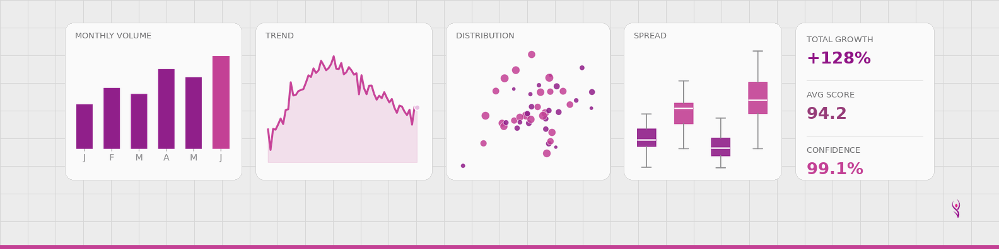

<picture>
  <source media="(prefers-color-scheme: dark)" srcset="banner-dark.png">
  <source media="(prefers-color-scheme: light)" srcset="banner-light.png">
  
</picture>

# Hi, I'm RoShawn Frazier 👋

**Data Analyst | Machine Learning | Army Veteran | 10+ Years Enterprise IT (L3Harris)**

I'm a data analyst with a Master's in Information Systems (Data Administration & Management) and over a decade of enterprise IT experience in the defense sector. I turn messy data into clear answers: collecting it, cleaning it, querying it, visualizing it, and building models that predict what happens next. I bring analytical rigor, technical depth, and the discipline that comes from military service to every project.

---

## 🚀 Featured Projects

### [SpaceX Falcon 9 Landing Prediction](https://github.com/RoShawn-F/spacex-falcon9-landing-prediction)
*IBM Data Science Professional Certificate capstone · It's not a phase, it's a pipeline.*

An end-to-end project predicting whether a Falcon 9 first stage will land, which determines whether a launch costs about $62M or $165M+.
- Collected launch data from the **SpaceX REST API** and by **web scraping** Wikipedia with BeautifulSoup
- Cleaned the data, engineered a landing label, and explored it with **SQL** and **seaborn**
- Built **interactive Folium maps** of launch sites and a **Plotly Dash** dashboard
- Trained and tuned **Logistic Regression, SVM, Decision Tree and KNN** models with GridSearchCV: best model **88.9% validation / 83.3% test accuracy**
- 📊 [View the final presentation](https://github.com/RoShawn-F/spacex-falcon9-landing-prediction/blob/main/SpaceX%20Capstone%20-%20Crimson%20Edition.pdf)

### [Rain Prediction in the Melbourne Area](https://github.com/RoShawn-F/rain-prediction-ml)
*IBM Machine Learning with Python final project*

A classification model predicting same-day rain from the previous day's weather, built with a scikit-learn pipeline.
- Reframed the problem to **avoid data leakage** and engineered a seasonal feature
- Compared **Random Forest** and **Logistic Regression** with stratified cross-validation
- Evaluated beyond accuracy on an imbalanced target: recall, precision, and confusion matrices
- **Random Forest: 84% accuracy**, with afternoon humidity as the strongest predictor

---

## 🛠️ Tools & Skills

- **Languages:** Python, SQL
- **Python Libraries:** pandas, NumPy, scikit-learn, Matplotlib, Seaborn, Requests, BeautifulSoup, openpyxl
- **Machine Learning:** Classification (Logistic Regression, SVM, Decision Tree, KNN, Random Forest), Pipelines, GridSearchCV, Model Evaluation
- **Visualization & Dashboards:** Plotly Dash, Folium, Power BI, Tableau, Excel (Pivot Tables, VLOOKUP)
- **Databases:** SQLite, MySQL, MongoDB
- **Platforms:** Jupyter, GitHub, ServiceNow, JIRA, MS Project, Remedy, Azure, VMware
- **Competencies:** Data Cleaning & Validation, Exploratory Data Analysis, Root Cause Analysis, Requirements Analysis, UAT/QA Testing, Trend Reporting

---

## 📚 Certifications

### ✅ IBM Data Science Professional Certificate (Coursera), completed October 2026

12 courses, from Python, SQL, and data visualization through machine learning, the Applied Data Science Capstone, Generative AI: Elevate Your Data Science Career, and Data Scientist Career Guide and Interview Preparation.

**Also:** Python Programming (VetsinTech) · Six Sigma Lean White Belt

---

## 🎖️ Background

- U.S. Army Veteran (HHC COSCOM)
- ~10 years at L3Harris Technologies (defense contracting): IT deployment and project coordination across a secure multi-building campus
- MS, Information Systems (Data Administration & Management), Keller Graduate School of Management
- BS, Management of Technology, DeVry University

---

## 📫 Connect With Me

- 💼 [LinkedIn](https://www.linkedin.com/in/roshawn-frazier)
- 📧 <ms_frazier18@outlook.com>
